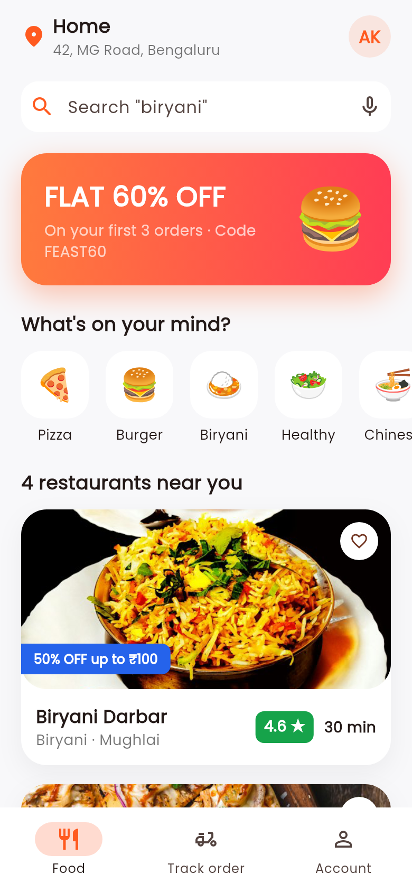
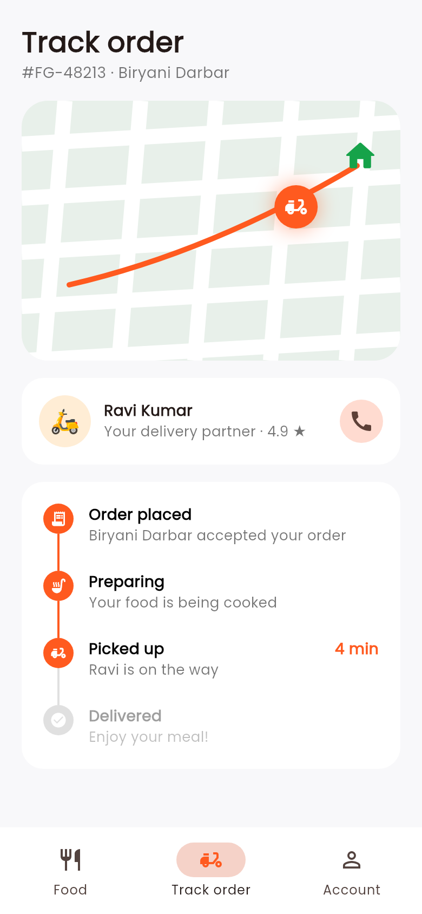
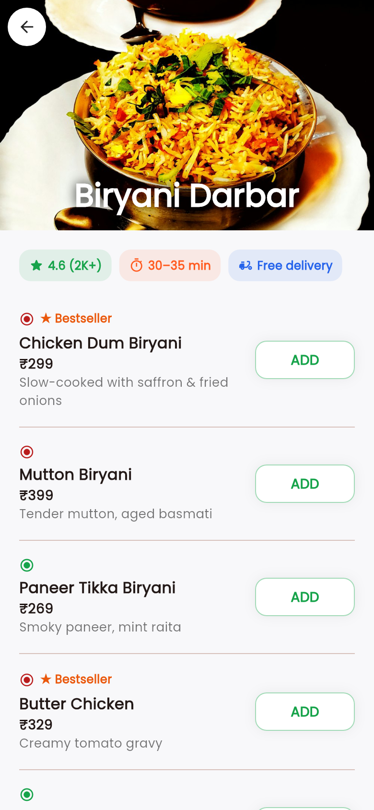

# Food Delivery App Development | Custom Food Ordering App Solutions

**Naya Prayog Technologies** provides custom **Food Delivery App Development** services for restaurants, food businesses, cloud kitchens, food delivery startups, and entrepreneurs.

We develop tailored food ordering and delivery solutions designed to connect customers, restaurants, delivery partners, and administrators through an integrated digital platform.

Whether you want to launch a single-restaurant food ordering application, a multi-restaurant delivery marketplace, or a complete food delivery business, we can help you plan and develop a solution around your business model.

<!-- screenshots -->
## Screenshots

<table>
  <tr>
    <td align="center"><b>Home</b>  </td>
    <td align="center"><b>Live Order Tracking</b>  </td>
    <td align="center"><b>Restaurant Menu</b>  </td>
  </tr>
</table>

## What Is Food Delivery App Development?

Food Delivery App Development involves building digital platforms that allow customers to discover restaurants, browse menus, place food orders, make payments, and receive deliveries.

A complete food delivery ecosystem can include:

- Customer mobile application
- Restaurant or vendor management panel
- Delivery partner mobile application
- Super admin dashboard
- Backend APIs and database
- Payment gateway integration
- Order tracking and notification services

Naya Prayog Technologies develops custom food delivery applications for businesses looking to establish or expand their online food ordering operations.

## Food Delivery App Development Solutions

### 1. Customer Food Ordering App

A customer-facing application can provide a convenient experience for discovering restaurants and ordering food.

Potential features include:

- Customer registration and login
- User profile management
- Location and address management
- Restaurant discovery
- Restaurant details and operating information
- Food categories and menu browsing
- Product descriptions and images
- Search and filters
- Food customisation and add-ons
- Shopping cart
- Order placement
- Coupon and discount management
- Online and cash payment options where supported
- Order history
- Live order status
- Delivery tracking
- Ratings and reviews
- Push notifications
- Favourite restaurants and dishes

### 2. Restaurant and Vendor Management Panel

A restaurant management panel can help restaurant owners manage their online food ordering operations.

Potential features include:

- Restaurant registration and profile management
- Restaurant verification workflows
- Menu management
- Food category management
- Item pricing and availability
- Food customisation and add-ons
- Incoming order management
- Order acceptance and rejection
- Food preparation status
- Estimated preparation time
- Restaurant operating hours
- Offers and discounts
- Sales reports
- Order history
- Restaurant staff management

### 3. Delivery Partner App

A dedicated delivery application can help delivery personnel manage assigned food orders.

Potential features include:

- Delivery partner registration
- Profile and document management
- Availability status
- Online and offline status
- Order assignment
- Delivery request acceptance
- Pickup location information
- Customer delivery address
- Navigation and map integration
- Order pickup confirmation
- Delivery status updates
- Delivery history
- Earnings summaries
- Delivery notifications

### 4. Super Admin Dashboard

A centralised administration dashboard can help platform owners manage the entire food delivery ecosystem.

Potential features include:

- Customer management
- Restaurant and vendor management
- Delivery partner management
- Restaurant verification
- Food category management
- Order monitoring
- Order assignment management
- Commission configuration
- Payment and transaction records
- Coupon and promotional management
- Customer support management
- Reports and analytics
- Platform settings
- Role-based access control

## Essential Food Delivery App Features

### Online Food Ordering

Allow customers to browse menus, customise food items, add products to their cart, and place orders through a mobile or web application.

### Restaurant Management

Provide restaurant owners with tools to manage menus, food availability, incoming orders, pricing, and daily operations.

### Real-Time Order Tracking

Order tracking capabilities can help customers follow order progress through stages such as:

- Order placed
- Order confirmed
- Food preparation
- Ready for pickup
- Picked up by delivery partner
- Out for delivery
- Delivered

Real-time location tracking depends on the selected mapping and location services.

### Multiple Payment Options

Payment functionality can be developed around supported payment providers and business requirements.

Potential payment options include:

- UPI
- Debit and credit cards
- Net banking
- Digital wallets
- Cash on delivery
- Online payment gateways

### Commission and Revenue Management

For marketplace-based platforms, revenue management can include:

- Restaurant commission configuration
- Order-wise commission calculation
- Platform service charges
- Delivery charges
- Promotional discounts
- Restaurant settlement records
- Payment transaction reports

Payment settlement and payout automation depend on the selected payment provider and integration scope.

### Offers and Promotions

- Discount coupons
- Restaurant-specific offers
- First-order discounts
- Promotional campaigns
- Minimum order offers
- Customer-specific promotions
- Loyalty and reward programmes

## Types of Food Delivery Applications We Develop

### 1. Single Restaurant Food Delivery App

A customised ordering and delivery platform for an individual restaurant or food business.

### 2. Multi-Restaurant Food Delivery Marketplace

A marketplace connecting multiple restaurants with customers through a shared ordering platform.

### 3. Cloud Kitchen Food Ordering App

A digital ordering platform for cloud kitchens, takeaway businesses, and delivery-only food brands.

### 4. Restaurant Chain Delivery App

A centralised platform for restaurant chains operating across multiple branches and locations.

### 5. Food Delivery Startup Platform

A custom platform for entrepreneurs launching their own food ordering and delivery business.

### 6. White-Label Food Delivery App

A branded food ordering solution that can be customised with a business's name, branding, workflows, and required features.

## Food Delivery App Development for Android, iOS, and Web

Naya Prayog Technologies provides custom application development across multiple platforms.

Potential deliverables include:

- Android food delivery application
- iOS food delivery application
- Restaurant management web panel
- Delivery partner mobile application
- Super admin web dashboard
- Customer web ordering platform
- Backend APIs
- Database and cloud deployment

Technology selection depends on the project architecture, performance requirements, budget, and business objectives.

## Our Food Delivery App Development Process

### 1. Requirement Analysis

Understand your food delivery business model, target customers, operational workflows, and required application modules.

### 2. UI/UX Design

Plan user journeys, application screens, restaurant dashboards, delivery workflows, and administration interfaces.

### 3. Application Development

Develop the customer application, restaurant panel, delivery partner application, backend services, and administration dashboard.

### 4. API and Third-Party Integrations

Integrate required services such as payment gateways, maps, notifications, and communication providers.

### 5. Testing and Quality Assurance

Test application workflows, order processing, payment scenarios, user permissions, and platform performance.

### 6. Deployment and Launch Support

Prepare the agreed applications and backend services for deployment, hosting, and release.

The actual project process and deliverables depend on the agreed development scope.

## Why Choose Naya Prayog Technologies?

- Custom food delivery app development
- Android and iOS application development
- Multi-restaurant marketplace solutions
- Restaurant and vendor management systems
- Delivery partner application development
- Custom admin dashboards and backend APIs
- Payment and third-party service integrations
- Scalable application architecture
- Business-specific workflows and automation
- Project-specific technical support

We focus on building practical digital products that help businesses establish, manage, and grow their online food ordering operations.

## Our Related Software Development Services

- Food Delivery App Development
- Restaurant Management Software Development
- Restaurant POS Software Development
- Grocery Delivery App Development
- Medicine Delivery App Development
- E-commerce Application Development
- Multi-Vendor Marketplace Development
- Custom Mobile App Development
- Flutter App Development
- Backend and API Development

## Frequently Asked Questions

### How much does food delivery app development cost?

The development cost depends on the number of applications, required features, design complexity, integrations, backend architecture, and deployment requirements. Contact our team for a project-specific estimate.

### Can you develop a multi-restaurant food delivery application?

Yes. We can develop a multi-restaurant platform with customer ordering, restaurant dashboards, delivery partner applications, and central administration, depending on the project scope.

### Can you build Android and iOS food delivery apps?

Yes. Naya Prayog Technologies provides Android and iOS mobile application development services.

### Can restaurants manage their own menus and orders?

A restaurant dashboard can be developed to manage menus, pricing, item availability, incoming orders, preparation status, and restaurant operations.

### Can customers track their food orders?

Order status tracking and live delivery location tracking can be developed using suitable backend and mapping integrations.

### Can I start my own food delivery business using a custom application?

Yes. We can help plan and develop a food delivery platform around your business model, including customer applications, restaurant management, delivery operations, and administration.

### Can you develop a white-label food delivery application?

Yes. A white-label solution can be customised with your business branding, application design, features, and operational workflows.

### Do you provide backend and admin panel development?

Yes. Backend APIs, database architecture, restaurant dashboards, delivery management, and super admin panels can be included in the development scope.

## Discuss Your Food Delivery App Project

Looking for a reliable **Food Delivery App Development Company**?

Whether you are a restaurant owner, startup founder, cloud kitchen operator, or entrepreneur, Naya Prayog Technologies can help you plan and develop a custom food ordering and delivery platform.

**Naya Prayog Technologies**

- Website: https://nayaprayog.com/
- Email: [support@nayaprayog.com](mailto:support@nayaprayog.com)
- Phone / WhatsApp: +91 7991327022
- WhatsApp: https://wa.me/917991327022
- Portfolio: https://github.helloharendra.io

**Build your food delivery platform. Connect restaurants and customers. Grow your digital food business.**

---

## Repository Information

This repository showcases Naya Prayog Technologies' food delivery app development services and potential solution capabilities.

For customisation, pricing, implementation, or project enquiries, contact our team.

**Note:** This repository is a proprietary service and solution showcase. It does not grant permission to redistribute, resell, or commercially use Naya Prayog Technologies' proprietary materials or intellectual property.
